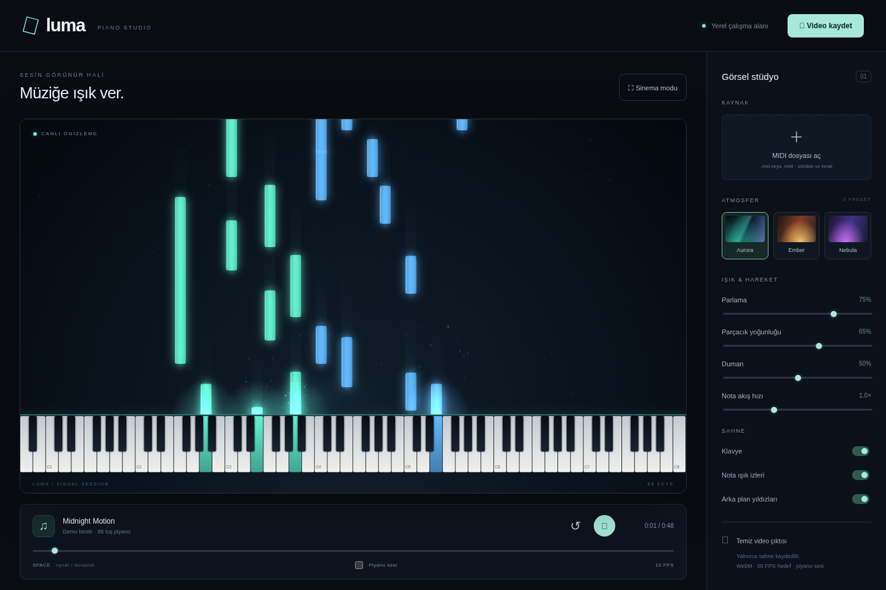
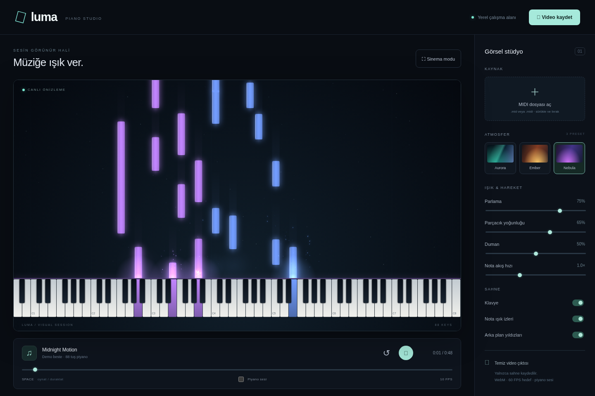

# LumaRoll Studio

> Work in progress.

An experimental Electron music-visualization studio inspired by piano-roll visualizers. It renders MIDI notes across an 88-key piano with animated lighting, color palettes, particles, and recording controls.

## Features

- MIDI file loading and demo playback
- 88-key piano-roll visualization
- Adjustable visual effects and color palettes
- Cinema mode and WebM recording
- Web Audio piano synthesis
- Browser preview through Vite

## Development

```bash
npm install
npm run dev
```

Run the desktop build with `npm start`, create a production web build with `npm run build`, and run the automated tests with `npm test`.

This is a work-in-progress prototype. Live MIDI input, sampled concert piano, pedal interpretation, MP4 export, and offline frame rendering are not currently included.

<!-- project-screenshot-gallery:start -->
## Ekran görüntüleri

<p>
  <a href="docs/screenshots/readme/01-aurora.png"></a>
  <a href="docs/screenshots/readme/02-nebula.png"></a>
</p>
<!-- project-screenshot-gallery:end -->
